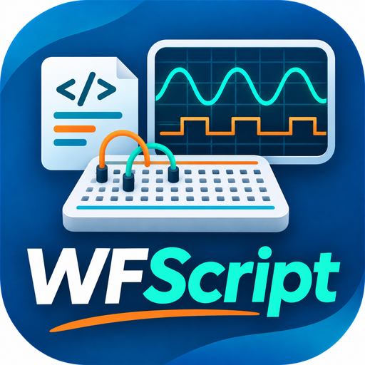

# WFScript

**WFScript** is an independent desktop application for building interactive instrument panels, writing JavaScript automation, and running automated test sequences with Digilent Analog Discovery devices.

This **v0.1** release is the first public source release. It combines a Qt-based Panel Designer, a JavaScript editor with autocomplete/F1 help, a long-lived runtime, plotting widgets, editable data tables, and a native Test Executive for automated test flows.



## What WFScript does

WFScript lets you:

- design and save editable multi-Page `.wfpanel` projects;
- attach JavaScript to widgets and panel events;
- control supported Analog Discovery / WaveForms SDK features through native C++ bridges;
- build custom operator panels, lab tools, and educational demonstrations;
- create automated test flows with setup/main/cleanup steps, limits, run information, archived JSON reports, and a results browser;
- use experiment-oriented widgets such as engineering charts, digital displays, equations, embedded images, and editable tables.

WFScript is **not** the official Digilent WaveForms application and does not aim to replace every WaveForms feature. It is an independent project built around a workflow focused on **custom panels, scripting, examples, and test execution**.

## Release status

The underlying **v5.7.0.12 source baseline** was validated by the project owner on **Windows with Qt 6.9.2 / MinGW 64-bit**. This v0.1 repackaging (new version labels, icon, release docs and license) **still needs a clean Windows build and full CTest run** before publication.

Validation already completed on the underlying source baseline:

- WFScript application compiled and launched successfully.
- The previous source baseline completed a full native CTest run with **66 / 66 passing tests**.
- Manual editor/autocomplete checks passed.
- The **AD3 Hardware Test Station** example was run by the owner and completed successfully on real hardware.

**Warning-cleanup candidate:** The new source changes in this ZIP have not yet been compiled or tested on Windows. Build All and rerun the native suite before publishing this snapshot.

## Highlights

- **Panel Designer** with multiple Pages, drag/drop widgets, property editing, and a shared JavaScript runtime.
- **JavaScript editor** with syntax highlighting, code completion, F1 help, API Explorer, and module support.
- **Examples Library** with grouped examples for getting started, graphics, tables/data, analog instruments, digital instruments, and test sequences.
- **Experiment tables** that round-trip as **native JavaScript arrays** via `ui.get()`.
- **Engineering plots and digital timing charts** for operator panels and educational visualizations.
- **Native Test Executive** with Setup/Main/Cleanup, numeric limit evaluation, run information, JSON archive, and results browser.
- **Simulation-first workflow** so panels can be developed safely before touching real hardware.

## Example groups

The built-in examples are organized into these categories:

- **Getting Started**
- **Graphics & Charts**
- **Tables & Data**
- **Analog Instruments**
- **Digital Instruments**
- **Test Sequences & Executive**

Recommended examples for a first look:

| Group | Example | Why it is useful |
| --- | --- | --- |
| Getting Started | Getting Started | Tour the core workflow and common widgets |
| Tables & Data | Table-Driven Wavegen | Read operator-entered table rows as JS arrays and use them to drive acquisitions |
| Tables & Data | Table-to-Plot — Limits and Observations | Turn editable table data into plotted nominal/observed/limit curves |
| Analog Instruments | Signal Lab | Quick analog control and visualization |
| Digital Instruments | Sequence Lab | Digital sequence concepts and pattern examples |
| Test Sequences & Executive | AD3 Hardware Test Station | Real test flow with cleanup, limits, and archived results |

## Requirements

- **Windows** development environment tested with **Qt 6.9.2** and a matching **Desktop MinGW 64-bit kit**
- **CMake 3.21+**
- Qt6 **Widgets** and **Qml** modules
- Optional physical-device use with **Digilent WaveForms** installed so that `dwf.dll` is available at runtime

The repository does **not** include Digilent binaries.

## Build on Windows

Detailed instructions are in [docs/BUILD_WINDOWS.md](docs/BUILD_WINDOWS.md).

Quick Qt Creator path:

1. Extract or clone the repository to a short path such as `C:\Dev\WFScript`.
2. Open `CMakeLists.txt` in Qt Creator.
3. Select your installed **Desktop Qt 6.9.2 MinGW 64-bit** kit.
4. Configure a fresh build directory.
5. Build the `WFScript` target.
6. Run the application and start with the built-in examples in **Simulation** mode.

## Run the tests

Detailed instructions are in [docs/TESTING.md](docs/TESTING.md).

After configuring with `-DWFSCRIPT_BUILD_TESTS=ON`, the full native suite can be run with:

```powershell
ctest --test-dir <your_build_directory> -j 2 --output-on-failure
```

The underlying source baseline passed **66 tests with 0 failures**. Re-run all tests on the clean v0.1 build before publishing.

## Documentation map

- [docs/BUILD_WINDOWS.md](docs/BUILD_WINDOWS.md) — build and run instructions
- [docs/TESTING.md](docs/TESTING.md) — automated and manual test workflow
- [docs/SCRIPT_REFERENCE.md](docs/SCRIPT_REFERENCE.md) — practical WFScript JavaScript reference
- [docs/ARCHITECTURE.md](docs/ARCHITECTURE.md) — application structure
- [docs/PANEL_PROJECT_ARCHITECTURE.md](docs/PANEL_PROJECT_ARCHITECTURE.md) — `.wfpanel` storage notes
- [docs/WFPANEL_EXPERIMENT_WIDGETS.md](docs/WFPANEL_EXPERIMENT_WIDGETS.md) — equation/image/table-related widget notes
- [docs/QT_OPEN_SOURCE_NOTES.md](docs/QT_OPEN_SOURCE_NOTES.md) — Qt licensing and redistribution notes
- [examples/README.md](examples/README.md) — built-in examples overview

## License

WFScript source code in this repository is licensed under the **GNU Lesser General Public License v3.0**. See the repository root [LICENSE](LICENSE).

Qt itself is available under commercial and open-source licensing models. This repository is intended for use with the Qt open-source edition in a way compatible with LGPL v3. See [docs/QT_OPEN_SOURCE_NOTES.md](docs/QT_OPEN_SOURCE_NOTES.md).

## Status and scope

This is an **early public source release (v0.1)**. The application is already useful, but still Windows-first and actively evolving. Physical hardware coverage is selective rather than exhaustive, and simulation is not a substitute for safe bench validation.

## Attribution

WFScript is an **independent project** and is not developed, endorsed, or supported by Digilent or NI. Digilent, Analog Discovery, and WaveForms are trademarks of their respective owners.
