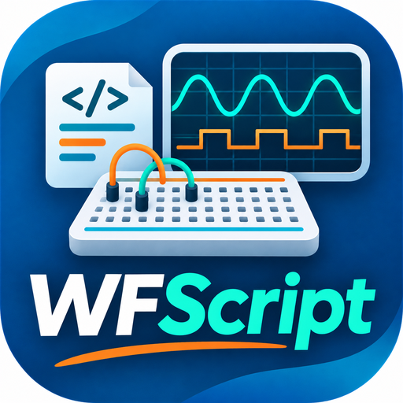
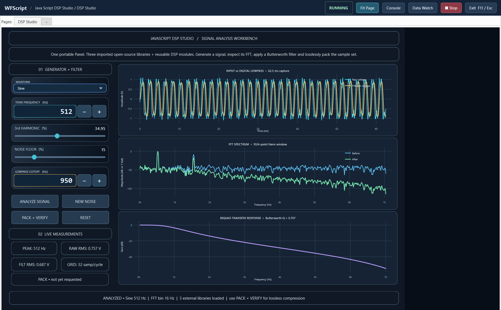

# WFScript v0.2

**Build useful measurement, control, and test applications with Qt and JavaScript.**

WFScript is an open-source Windows-first desktop application that brings together a visual
Panel Designer, a JavaScript runtime, reusable instrument interfaces, live charts,
communications, and a native automated Test Executive. Develop a Panel, run it immediately,
and refine it without recompiling your JavaScript.



## See what you can build



From a small interactive dashboard to a fully instrumented test station, the same `.wfpanel`
project can contain your interface, JavaScript, event bindings, Pages, and embedded libraries.
The **40 built-in examples** are ready to explore, including DSP Studio, Panel Data Lab,
communications demos, AD3 instruments, RC experiments, and automated testing.

**[Read the illustrated Getting Started guide](docs/manuals/WFScript_Getting_Started.pdf)**  ·\
**[Explore the documentation](docs/README.md)**  ·\
**[Browse the 41 example walkthroughs](docs/site/examples.html)**  ·\
**[Read the v0.2 release notes](RELEASE_NOTES_v0.2.md)**

## Try WFScript Web Studio

[**Launch WFScript Web Studio**](https://openpilab.github.io/WFScript/WFScript_Web_Studio.html) ·\
[**User Guides for Web version**](https://openpilab.github.io/WFScript/WFScript_Complete_Illustrated_User_Guide_Series.zip)

Design graphical applications, write JavaScript, communicate with devices and internet services, and develop automated test sequences directly in your browser.

- No installation or account required.
- 30 built-in executable example applications.
- Visual application and Test Sequence Editors.
- Portable `.wfpanel` application files.
- Downloadable for offline development.

Everything runs locally in your browser.

## Highlights

| Capability | What it enables |
| --- | --- |
| Visual Panel Designer | Multi-Page applications with professional controls, plots, labels, images, tables, and measurement displays |
| JavaScript runtime | Event-driven scripts, embedded reusable `.mjs` modules, editor completion and contextual help |
| Panel Data | Typed, named and computed state, data bindings, and change notifications |
| Plotting and analysis | Analog/digital charts, native sample data, DSP, measurements and analysis examples |
| Instruments | Digilent Analog Discovery through the separately installed WaveForms/DWF SDK; optional external SCPI drivers as Panel libraries |
| Communications | Native TCP, UDP, serial/COM, and instrument protocols |
| Persistence | CSV/JSON FileIO, SQLite, saved Panels and automated test reports |
| Test Executive | Visual test sequences, numeric limits, nested sweeps, conditional branches, asynchronous callbacks and cleanup |
| Operator View | Run the same project as a focused, full-screen operator application |

## Getting started

1. Install **Qt 6.9.2** (Windows Qt Widgets, QML, SQL, Network and **SerialPort**) and a matching MinGW 64-bit kit, along with CMake and Qt Creator.
2. Clone this repository or extract the source archive. Open `CMakeLists.txt` in Qt Creator and select a matching kit.
3. Enable `WFSCRIPT_BUILD_TESTS=ON` and build **All**. See [Windows build instructions](docs/BUILD_WINDOWS.md).
4. Launch `WFScript.exe`, open **Panel Designer → Examples → Getting Started**, then run the Panel.
5. Read the [Getting Started guide](docs/manuals/WFScript_Getting_Started.pdf) and explore the [User Guide](docs/manuals/WFScript_User_Guide.pdf).

A Digilent device is **not required** to explore the visual editor, scripting, communications examples,
or the simulation-only Panels. Physical AD3 operations require a separate installation of Digilent
WaveForms to provide `dwf.dll`; no proprietary Digilent SDK binaries are redistributed here.

## Build and regression tests

The owner-built **RC1.5.14.10.8 source baseline** compiled with Qt **6.9.2 MinGW 64-bit Release**
and passed **116/116 native CTests** on Windows (November 20, 2026).
That is a tested development baseline, not proof of a fresh GitHub checkout, MSVC CI,
deployment to a clean PC, or every physical instrument workflow.

```powershell
py -3 tools/check_repo.py
py -3 tools/build_examples.py --check
py -3 tools/check_release.py
py -3 tools/run_regression_gate.py  # Node.js needed for JS mocks

# After configuring a build with WFSCRIPT_BUILD_TESTS=ON:
ctest --test-dir "<your build directory>" --output-on-failure
```

For Qt runtime DLLs and PowerShell `PATH` setup, see [Testing WFScript](docs/TESTING.md).
The repository includes a GitHub Actions Windows build and native-test workflow.

## Safety and scope

WFScript is **not safety-rated**. Real instrument outputs can remain energized after a
connection failure, process stop, or device error; a TCP disconnect is not a hardware interlock.
Verify external outputs independently and use appropriate hardware safeguards.

WFScript is independent of and is not endorsed by Digilent, NI, or Rigol.
External Rigol instrument libraries in user Panels are separate from WFScript's built-in
JavaScript API. The optional v0.7.2 dual-channel/RAW Rigol workflow is not yet physically validated.

## Project and license

- [Documentation home](docs/README.md) · [API reference](docs/site/api-reference.html)
- [Built-in examples](examples/README.md) · [Contributor guide](CONTRIBUTING.md)
- [Release notes](RELEASE_NOTES_v0.2.md) · [Changelog](CHANGELOG.md)
- [Issue tracker](https://github.com/OpenPiLab/WFScript/issues) · [Existing v0.1 release](https://github.com/OpenPiLab/WFScript/releases/tag/v0.1)

WFScript's source is licensed under **LGPL-3.0**. See [LICENSE](LICENSE),
[third-party notices](LICENSES/), and [Qt licensing notes](docs/QT_OPEN_SOURCE_NOTES.md)
when distributing binaries. Existing Git history and the v0.1 tag should be preserved.
