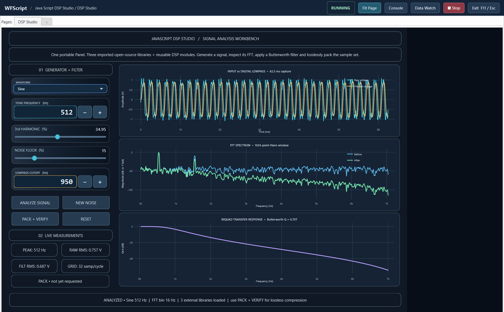
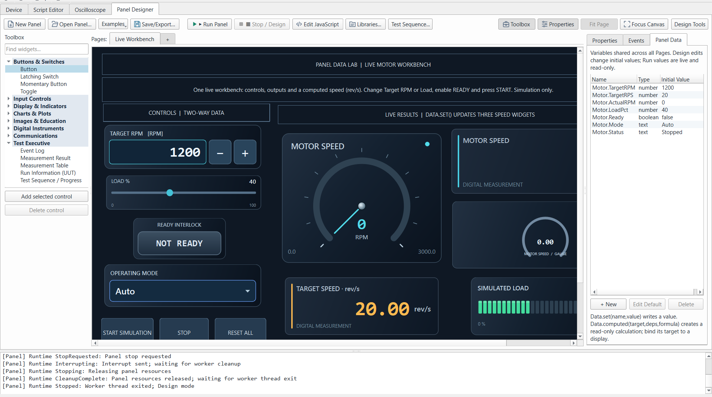
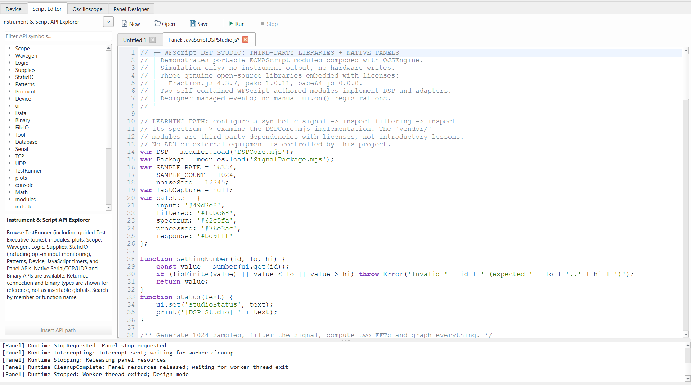
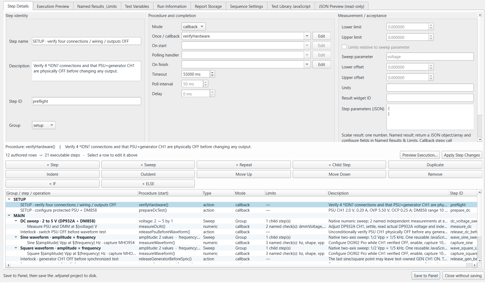
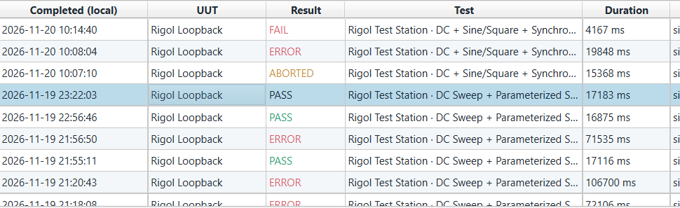

# Getting Started with WFScript

**Build an application, not just a script.**

WFScript combines a visual Panel Designer, a JavaScript runtime, native instrumentation, charts, and a Test Executive in one Windows application. You arrange the interface, give its controls meaningful IDs, and connect user actions to JavaScript procedures. When the Panel runs, those same components become an operator interface.



*The DSP Studio is a bundled, simulation-only example. It demonstrates interactive controls, native plots, and reusable JavaScript modules without requiring hardware.*

This guide follows the shortest useful path: open an example, change it, build a small Panel from scratch, work with shared data, then explore instrumentation and automated testing. You do not need to connect an Analog Discovery 3 or a Rigol instrument to complete the first exercises.

## 1. A map of the workspace

WFScript has a few distinct working areas. The **Panel Designer** is where you arrange Pages and widgets; **Script Editor** is where you write JavaScript; device-specific tools expose the instrument APIs; and the **Test Sequence Editor** lets you define native, reportable test steps.

| Area | What you do there | What it produces |
|---|---|---|
| Panel Designer | Add Pages, widgets, IDs, styles, events, and shared variables | A visual application |
| Script Editor | Write functions, callbacks, processing code and module calls | Application behavior |
| Properties / Events | Configure the selected widget and connect events to named handlers | Saved, inspectable event bindings |
| Properties / Panel Data | Define typed values shared across Pages | State and value bindings |
| Test Sequence Editor | Configure Setup, Main, Cleanup, limits, sweeps, branching and reports | A project-owned automated test |
| Operator View | Use the Panel as an application, without developer controls | The working interface |

A **Panel** is the complete project, normally saved as a `.wfpanel` file. A Panel can contain multiple Pages, controls, JavaScript, embedded libraries, data definitions, and a Test Executive. It is not just a screenshot of a UI or a link to an external script.

## 2. Open your first example

From **Panel Designer**, choose **Examples** and open **Getting Started**. It has a Guide Page and an Events Tutorial Page. Read the Guide Page, then switch to **Events Tutorial**.

In Design mode, select the **CLICK ME** button, open **Properties → Events**, and inspect its `clicked` binding. The saved handler is `onTourButtonClicked()`. Use **Go to Handler** to jump to the implementation in the script editor. This illustrates an important rule: a widget's event binding belongs to the Panel project; JavaScript supplies the named function that runs when the event fires.

Choose **Run Panel**, click the tutorial button twice, and watch the count change. Then use **Stop / Design**, change a line in the handler, and run again. A developer can iterate on a Panel without rebuilding the C++ application.

> The bundled example is the authority for the exact handler body. Do not replace its counter code with the shorter snippets in an introduction unless you intend to change its behavior.

## 3. Understand Design and Run

**Design mode** is for editing layout and properties. Selecting a widget opens its configuration instead of performing the operator action. **Run mode** starts the Panel's JavaScript runtime and makes those controls operational.

A focused operator view gives the application more space, hiding most editing tools. **F11** or **Esc** restores the development layout without necessarily stopping the active Panel. **Stop / Design** ends the Panel runtime and returns it to editing mode. That difference is useful when debugging: you can inspect live data without treating every change of view as a new run.

Save a copy of examples under your own `.wfpanel` filename before making extensive changes. Run-time values are not always the saved design-time defaults; Panel Data initial values, for example, belong to the project, while its live values belong to the current execution.

## 4. Build your first Panel from a blank Page

Let's create an ideal voltage-divider calculator. This exercise covers the full design → JavaScript → run loop and has a result you can check by hand. **It calculates a voltage; it does not measure one.**

Add these controls to a new Panel. In each Properties pane, set the **ID** exactly as shown. Use sensible initial values and any compact layout you like.

| Widget | ID | Caption | Initial value |
|---|---|---|---|
| Numeric Stepper | `supplyVoltage` | Supply (V) | `5` |
| Numeric Stepper | `topResistor` | R1 (kΩ) | `10` |
| Numeric Stepper | `bottomResistor` | R2 (kΩ) | `10` |
| Digital Display | `dividerOutput` | Calculated output (V) | `0` |
| Label | `dividerStatus` | Status | Press CALCULATE |
| Button | `calculateButton` | CALCULATE | — |

Select the button and bind its `clicked` event to `onCalculateClicked` in **Properties → Events**. Open the script editor and add:

```javascript
function onCalculateClicked() {
    const vin = Number(ui.get('supplyVoltage'));
    const r1 = Number(ui.get('topResistor'));
    const r2 = Number(ui.get('bottomResistor'));

    if (![vin, r1, r2].every(Number.isFinite) || r1 <= 0 || r2 <= 0) {
        ui.set('dividerStatus', 'Enter positive resistor values.');
        return;
    }

    const volts = vin * r2 / (r1 + r2);
    ui.set('dividerOutput', volts);
    ui.set('dividerStatus', 'SIMULATED — ideal, unloaded divider.');
}
```

Run the Panel. With 5 V, 10 kΩ and 10 kΩ, the result should be **2.5 V**. Change R2 to 20 kΩ and the result becomes approximately **3.333 V**. Save the Panel as a new `.wfpanel` project.

**Why it works:** `ui.get()` reads a widget's current value; `ui.set()` updates a widget that is not already controlled by a Panel Data binding. The designer routes the click to the named handler. IDs, not visible captions, are the bridge between layout and code.

## 5. Make the calculation update automatically

The button can remain, but try binding all three Numeric Stepper controls' `valueChanged` events to the **same** `onCalculateClicked` function. You now have a reactive calculator without a separate hand-written event-registration block.

Do not add a second `ui.on()` subscription for an event already bound in the Events editor. Duplicating the connection can make an action run twice. The preferred pattern for user-created Panels is one visible saved event binding and one named function.

A common mistake is changing a widget's visible text and forgetting that JavaScript still refers to its ID. Captions can change freely; treat IDs like stable names in a program.

## 6. Work with shared Panel Data



A one-page calculator can read and write widgets directly. For applications with multiple Pages—or several controls showing the same value—use **Panel Data**. You declare a named typed value once, bind widgets to it, and allow the runtime to keep those displays synchronized.

Open **Examples → Panel Data Lab**. On its **Live Workbench** Page, inspect the controls on the left and the digital readouts and gauge on the right. In **Properties → Panel Data**, you will find variables including `Motor.TargetRPM`, `Motor.ActualRPM`, `Motor.LoadPct`, `Motor.Ready`, `Motor.Mode`, `Motor.Status`, and `Motor.TargetRPS`.

The example uses simulated speed, not a real motor. Several right-hand displays follow `Motor.ActualRPM`; changing that one variable updates them together. The derived `Motor.TargetRPS` is registered in JavaScript:

```javascript
Data.computed('Motor.TargetRPS', ['Motor.TargetRPM'], function(rpm) {
    return Number((rpm / 60).toFixed(2));
});
```

`Data.get(name)` reads a declared variable; `Data.set(name,value)` changes a writable variable; `Data.onChange()` notifies handlers when a value changes. A computed value becomes read-only for that run, so bind it to a display rather than an editable control.

When a widget has a **Value Binding** to Panel Data, update the variable with `Data.set()`, not the widget with `ui.set()`. The binding owns the widget value. This prevents two competing sources of truth.

## 7. Put JavaScript where it belongs



WFScript uses Qt's **QJSEngine**, not a browser or a Node.js process. Its JavaScript integrates with native APIs that are made available by the application. It can call `ui`, `Data`, `plots`, `Binary`, `FileIO`, `Database`, `Tool`, communications objects, and the selected instrumentation APIs in their supported contexts.

Most Panel scripts are easiest to maintain when they contain a short initialization section and a small set of descriptive event handlers. Move reusable signal processing, instrument drivers and substantial test logic into embedded `.mjs` libraries, loaded with `modules.load()` or referenced by the Test Executive.

Avoid using `wait()` to pause an interactive Panel: it blocks the script worker's event loop and delays updates or callbacks. Use native timers and asynchronous instrument operations for activities that should not freeze the interface.

The **Instrument & Script API Explorer**, autocomplete and F1 help can show the available methods. Consult the reference for their actual parameter contracts instead of guessing from a familiar API in another framework.

## 8. Explore interactive charts


Open the **JavaScript DSP Studio** example in Run mode. Try changing the waveform selection, frequency, noise and low-pass cutoff. The three plots show time-domain input/output, FFT, and a filter response. The example is intentionally simulation-only; it can demonstrate the display and signal processing before you connect an instrument.

Charts in WFScript can display calculated data or measured samples. A useful distinction is **data acquisition versus data presentation**: the Scope API obtains hardware samples; `plots` renders them. This separation lets a single chart display AD3 measurements, SCPI results, CSV data or synthetic data.

Zoom, inspect measurements, change series visibility, and compare what the plots reveal about the signal. When capturing large waveforms or using several traces, prefer the native bulk-data and chart APIs instead of making thousands of one-sample calls across the JavaScript/C++ boundary.

## 9. Understand the instrument boundary

WFScript can use the Digilent WaveForms SDK to control a connected **Analog Discovery 3**. The `Device`, `Scope1`, `Wavegen1`, `Supplies`, `StaticIO`, `Patterns1`, `Logic1` and `Protocol1` objects cover supported native instrument capabilities. Hardware features and valid ranges depend on the connected device.

The program can also control external instruments through **TCP/SCPI**. The Rigol examples demonstrate four devices: a DP932A supply, DM858 multimeter, DG902 Pro waveform generator and MHO954 oscilloscope. Those Rigol drivers are **embedded application libraries**, not built-in global WFScript APIs. The visual Test Station uses a guarded test-facing library, not a second direct socket per test step.

> Simulated Panel behavior is not evidence of physical measurement. A simulation message concerning the native hardware context does not necessarily mean that an independently connected TCP/SCPI instrument is simulated. Confirm the actual endpoint and output state before running hardware tests.

## 10. The Test Executive is more than a script loop



WFScript's Test Executive allows you to author an entire sequence in a visual editor. It owns Setup, Main and Cleanup, expands sweeps, evaluates conditions and named measurement limits, tracks each step's deadline, and records results.

A procedure can return a scalar or structured measurement object. In **callback mode**, it calls `TestRunner.complete(token,result)` or `TestRunner.fail(token,reason)` when the asynchronous operation finishes. A returned Promise is **not automatically awaited** by the Test Executive; the library must connect the Promise's completion to the current step token.

Open the **Automated Test Station** example with no hardware connected; its embedded `TestSteps.mjs` uses simulated measurements. In Design mode choose **Test Sequence**. Inspect a numeric step, change a limit, and review the result when the test runs. The sequence definition is stored in the Panel, not reconstructed by a startup JavaScript script.

## 11. Browse archived results



The **Test Results Browser** lets an operator search previous runs, inspect steps and measurements, review Run Information and export JSON/CSV data. Run metadata and numeric acceptance results are more useful when they are kept with the test record rather than copied into a console message.

The image is from an earlier development build. The sample Rigol entries should not be interpreted as validation of the newer synchronized dual-channel and RAW acquisition workflow, which remains pending physical verification.

## 12. Save, share and build with confidence

A `.wfpanel` is designed to keep Pages, widgets, script, event bindings, embedded libraries and the Test Executive definition together. Save a copy before experimenting with an example; use the source tree's readable `.js` files only if you are editing and rebuilding bundled examples.

When a project has external serial devices or TCP instruments, the project file cannot bundle physical cables, passwords or guarantee that a device is available. Document the required wiring, safe initial states, power-up behavior and cleanup in the application itself.

When you're ready for the next step, move to the **User Guide** for deeper workflows or the searchable **API Reference** for exact method signatures. WFScript should make it possible to go from an idea to a working measurement or test interface without turning every edit into a C++ rebuild.

---

**Source and validation note.** This edition is based on the WFScript RC1.5.14.10.8 source archive, including its built-in example guides. That version compiled and passed all 116 registered native CTests on Windows Qt 6.9.2 MinGW. Screenshots were provided from development sessions and may show an earlier title or an illustrative simulated run. The documentation itself is not a claim that every physical instrument feature has been verified.
