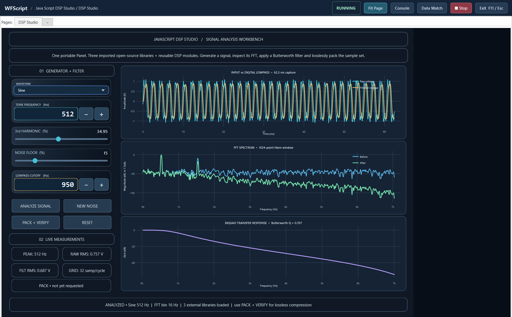
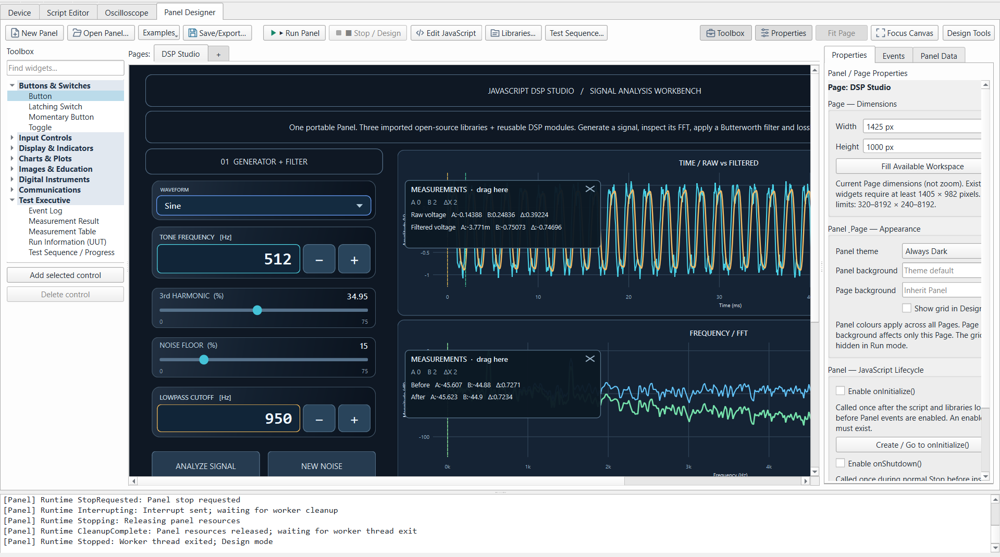
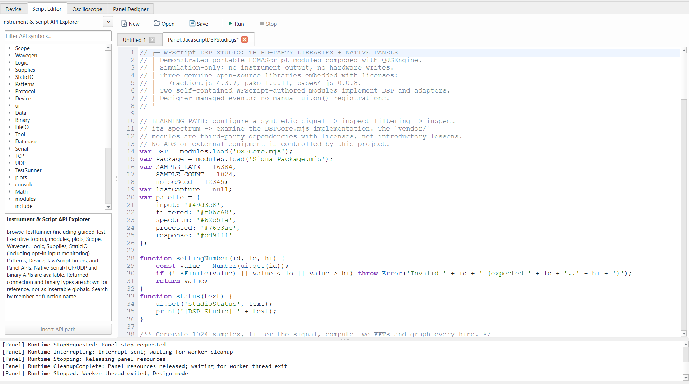
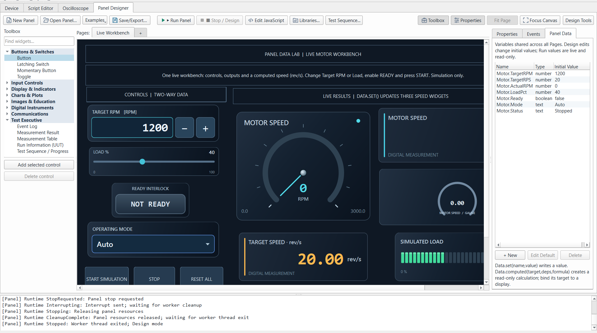
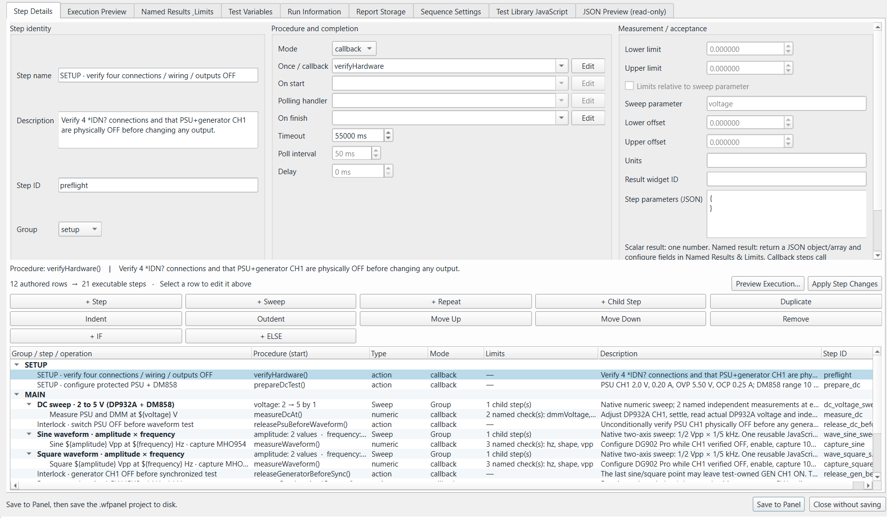
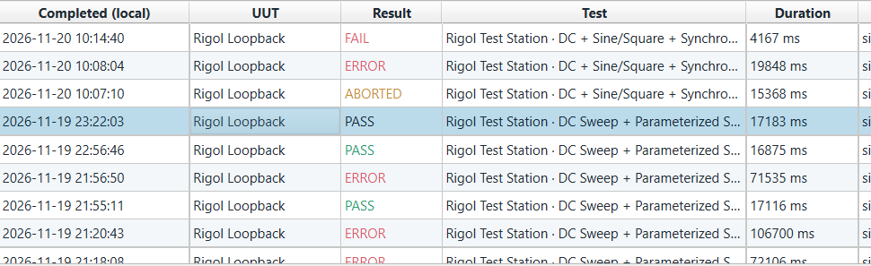

# WFScript User Guide

**Visual application development, JavaScript, data acquisition, and automated testing**



WFScript is a Windows Qt application for building interactive instrument and test software. A Panel is both the application project and the operator interface: it holds Pages, widgets, designer-managed events, JavaScript, optional libraries, named Panel Data, and an optional native Test Executive. This guide is organized around common jobs rather than the order in which the software's features were developed.

**Who this is for.** Developers, lab engineers, researchers, technicians and technically curious people who want to write software close to their measurements and equipment. Prior JavaScript experience helps, but the first chapters do not assume it. You can complete the initial workflows without physical instrumentation.

**Version basis.** RC1.5.14.10.8, source-verified and built with Qt 6.9.2 MinGW 64-bit on Windows; 116/116 registered native CTests passed. Public WFScript v0.1 remains a separate release. This guide distinguishes software-tested, simulated and physically verified capabilities.

## Chapter 1 — How WFScript fits together

A typical WFScript application has four layers. The **Panel Designer** stores the visual structure; the **JavaScript runtime** handles actions and calculations; native **bridges** perform Qt, file, communication and instrument operations; and the optional **Test Executive** schedules verifiable steps and creates reports.

Most simple applications use just the first two. A dashboard may add Panel Data and charts. An automated measurement application may use all four.

| Layer | Responsible for | Generally avoid putting here |
|---|---|---|
| Panel/Page | Layout, widget properties, visual event bindings, named variables | Instrument transaction sequences |
| Main Panel script | Initialization, UI event handlers, small application coordination | Hundreds of repetitive test procedures |
| Embedded modules | Reusable signal processing, drivers and operations | Hidden UI changes that make behavior hard to trace |
| Native Test Executive | Step state, timing, expansion, limits, Cleanup and report lifecycle | Ad-hoc scheduling through long blocking JavaScript loops |

A Panel can have many Pages but shares one active script environment during a run. When designing multi-page interfaces, use Pages to organize operator tasks rather than starting separate processes for each Page. A multi-page Panel is still one program.

### What the runtime is—and isn't

Panel scripts run in Qt **QJSEngine**, not Node.js or a browser. There is no implied browser DOM, `fetch()`, Node `require()` or Node filesystem module. WFScript supplies its own native services, such as `Serial`, `TCP`, `UDP`, `FileIO`, `Database`, `Binary`, `Tool`, `Data` and `plots` when available in the relevant context. Embedded `.mjs` libraries use the application's supported module mechanism.

The long-lived Panel script worker processes callbacks and Qt-backed events. A blocking JavaScript loop or `wait()` delays other work on that worker. Keep event handlers finite; schedule later actions with a timer or a bridge callback when possible.

### When to use the standalone Script Editor

Use it for concise experiments, API exploration and direct instrument exercises. Use a Panel when you want persistent controls, an operator interface, named shared data, communication sessions, or a visual test sequence. These are different contexts, and not every Panel-only global is available to standalone scripts.

## Chapter 2 — Panels, Pages and the design workflow



Start a Panel with **New Panel**, or open a bundled example. The left Toolbox groups widgets into control, display, chart, communication, education and test categories. The center canvas contains the Page; the right-hand pane shows Properties, Events and Panel Data.

Give each Page a name that describes the operator's task: *Overview*, *Measurements*, *Diagnostics*, *Report*. Page navigation is part of the application; it is not a separate browser route. You can create and resize Pages, customize their appearance, and choose a theme-following or fixed-dark presentation where supported.

### Naming a good Panel

The Panel filename should identify the application, not just the equipment. For example, `DC_Power_Qualification.wfpanel` is more informative than `Test1.wfpanel`. Use visible captions for the operator and stable widget IDs for code. A button could display **START TEST** while retaining the code ID `startTestButton`.

When saving, remember that **Save to Panel** in the Test Sequence Editor only commits that editor's work to the in-memory Panel project. It does not replace the separate Save/Export step that writes the `.wfpanel` file to disk.

### Choosing an example

The built-in examples are working projects, not slides. **Getting Started** demonstrates saved events; **Panel Data Lab** demonstrates shared typed values; **JavaScript DSP Studio** demonstrates charts and modules; **Automated Test Station** demonstrates the native test framework; and **AC Network Laboratory** and **RC Step Response Laboratory** show more elaborate analysis.

A fast way to understand a feature is to open the matching example in Design mode and compare three views: selected widget properties, the saved handler name, and the corresponding JavaScript function. You can then modify a small, isolated property and rerun.

### What belongs in an operator application

Operators should see the state of the process, clear primary actions, and meaningful feedback. Avoid putting a full source listing on the operator Page. Separate infrequent setup and diagnostics from controls used in every run. Use numeric units, explicit statuses and a concise representation of failures, not a dense wall of text.

## Chapter 3 — Widgets, styling and interaction

A widget has a **type**, a stable **ID**, properties and (for interactive types) events. Types range from simple Buttons and Labels to Numeric Steppers, sliders, latching switches, digital displays, meters, charts, tables, image and equation widgets, communication terminals, and Test Executive result displays.

An ID is the programmatic name. Keep it unique within the Panel model and avoid renaming it casually once scripts or data bindings depend on it. A caption tells the operator what the control does, and can change without changing code.

### The designer-managed event pattern

The usual workflow is: select widget → **Properties → Events** → choose the event → assign a named JavaScript function → run. The saved mapping survives project save/reopen and is visible to another developer. This is preferable to hiding dozens of `ui.on()` subscriptions in initialization code. Manual event subscriptions remain useful for advanced cases, but don't duplicate an existing designer binding.

```javascript
function onApplyClicked() {
    const requested = Number(ui.get('setpointInput'));
    if (!Number.isFinite(requested)) {
        ui.set('statusLabel', 'Enter a valid number');
        return;
    }
    ui.set('statusLabel', 'Requested: ' + requested);
}
```

This snippet updates a display only; it does not configure hardware. Connecting a setpoint to actual equipment requires additional range validation, connection readiness, output-state protection and error handling.

### Geometry, typography and themes

Choose a small set of visual patterns: consistent control height, predictable spacing, paired label/value displays, and colors that convey meaning rather than decorate everything. If an operator must read a value across a bench, use a large digital display instead of a small editable text box. Charts should have clear titles, channel labels and units.

WFScript has widget-level theme behavior and per-Panel appearance options. The completed UI should be checked in the chosen Run theme; not every QPalette color is the same in design and operator view. Test important interactions both with the focused Page and with the development panes visible.

### Which widget should I choose?

| Need | Usually use | Why |
|---|---|---|
| Operator action | Button or Momentary Button | Clear one-shot event |
| Persistent enable state | Latching Switch or Toggle | Reflects an ongoing Boolean value |
| Setpoint | Numeric Stepper | Constrained numeric input |
| Continuous adjustment | Slider | Direct manipulation with a visible range |
| Measurement | Digital Display or Measurement Result | Readable value, optional verdict context |
| State | Status Beacon, Label or Event Log | Clear status, descriptive messages |
| Trend and waveforms | Chart/Plot | Time, XY, digital or spectral view |
| Test report | Measurement Table, Sequence and Results Browser | Native result semantics |

When a widget acts as a read-only indicator, do not treat it as an operator input. For example, a status beacon is an output display; a Toggle is a better choice for a Boolean operator command.

## Chapter 4 — JavaScript, callbacks and modules



Write JavaScript to describe behavior, not to redraw widgets or poll every property continually. Most useful Panel scripts define a few constants, subscribe to genuinely asynchronous services, and expose named handlers for saved events.

The JavaScript editor includes syntax highlighting and integrated API exploration. API documentation and autocomplete are aids, not proof that a device supports every possible setting. Validate parameter ranges and read errors back from the actual bridge.

### A readable startup structure

```javascript
var refreshTimer = 0;

function onInitialize() {
    ui.set('statusLabel', 'Ready');
    // Start services only when this Panel needs them.
}

function onRefreshClicked() {
    ui.set('statusLabel', 'Refresh requested');
}

function onShutdown() {
    if (refreshTimer) clearInterval(refreshTimer);
}
```

The lifecycle hooks are optional and enabled in Panel properties where appropriate. Clean up timers and application sessions explicitly if you own them. The native runtime also manages certain resources as part of a normal stop, but an application's physical equipment state should never depend on a JavaScript handler being guaranteed after a sudden failure.

### Modules versus classic includes

Use `modules.load('MathTools.mjs')` for a modern embedded module with named exports. Use `include('Helpers.js')` for a classic script where appropriate. The two are not interchangeable with Node's package loader. A Panel may embed `.mjs` libraries so it can open on another computer without requiring the original external source tree.

```javascript
var dsp = modules.load('DSPCore.mjs');
var magnitude = dsp.magnitude(samples);
```

The example shows the call shape; `DSPCore.mjs` must be present in the Panel or a supported library location, and its actual export names must match the module. The bundled **JavaScript DSP Studio** demonstrates a source-backed module workflow.

### Timers are cooperative

`setTimeout()` and `setInterval()` use Qt's event loop in the Panel worker, with `clearTimeout()` and `clearInterval()` for cancellation. Intervals are best-effort; do not use them as a hard real-time clock or as a substitute for sample-accurate hardware capture.

```javascript
var updates = 0;
var timer = setInterval(function() {
    updates++;
    ui.set('counterLabel', 'Update ' + updates);
}, 250);
// Later: clearInterval(timer);
```

Use `Scope1` or `Logic1` for hardware-timed capture, not a `setInterval()` that toggles a DIO output and assumes microsecond accuracy.

### Error handling and console output

A value that *looks* numeric may be an overload, a disconnected measurement, or a failed query. Convert and validate explicitly. Use `print()`, `console.warn()` and `console.error()` where supported, then give the operator a concise status in the Panel. The Console can be filtered without erasing the original output history.

For asynchronous work, the error belongs in the callback or Promise rejection. A `try/catch` around the code that schedules a network request cannot catch a failure that arrives later unless that failure is explicitly propagated into a Promise chain.

## Chapter 5 — Shared Panel Data and computed values



Panel Data is the common state model for a multi-widget Panel. It allows several Pages and controls to use the same typed values while keeping view-specific IDs separate from application state.

Declare values in **Properties → Panel Data**. Typical types are Number, Boolean and Text, with optional choice-type constraints. The designer saves their initial values. The runtime exposes live values while the Panel runs; stopping does not automatically rewrite initial values in the project.

### Bind once, display many times

A motor dashboard might expose `Motor.TargetRPM`, `Motor.ActualRPM`, `Motor.Ready`, and `Motor.Mode`. A target control, large digital display and gauge can each reflect one or more of those values through Value Binding. Instead of separately pushing the same speed into three widgets, a script does:

```javascript
Data.set('Motor.ActualRPM', 1725.0);
```

All widgets bound to that value refresh. The value is still a **simulation** unless it originates from an actual instrument or sensor.

### Two ways to respond to change

Bind a widget's saved `valueChanged` event to a handler when you care about an operator action. Use `Data.onChange(name, callback, {immediate:true})` when you care about a shared variable regardless of which widget or script changed it.

```javascript
var watcher = Data.onChange('Motor.Ready', function(value) {
    ui.set('readinessLabel', value ? 'READY' : 'NOT READY');
}, {immediate:true});
```

Keep these callbacks small and avoid writing back the same value endlessly. The native bridge guards against unbounded notification feedback, but clear ownership of data is better than relying on a guard.

### Derived values belong in formulas

`Data.computed(target,dependencies,formula)` creates a run-time read-only derived value from existing declared variables. Dependencies are explicit, with values supplied to the function in the listed order.

```javascript
Data.computed('Motor.TargetRPS', ['Motor.TargetRPM'], function(rpm) {
    return rpm / 60;
});
```

A computed target must already be declared and should be bound to a read-only display. Its registration is evaluated at runtime; the formula lives in ordinary saved JavaScript. Use pure expressions—do not call `Data.set()` inside a computed formula. The source limits registration to 64 computed variables with 1–16 dependencies each.

### Why direct widget assignment can fail

A widget with a Value Binding is controlled by shared data. Calling `ui.set(widgetId, value)` for that bound value is rejected rather than silently competing with the binding. Correct the underlying variable via `Data.set(dataName, value)` or change the binding in Design mode.

## Chapter 6 — Charts and measurements

Charting is a core application feature, not an afterthought. WFScript can display calculated values, CSV rows, digital patterns, and instrument-captured samples. Its chart subsystem supports XY/time plots, digital timing views, cursors, inspection and native high-volume sample paths.

### Acquisition and display are separate jobs

Acquire samples with the correct device API, or construct a numerical array in JavaScript. Transform the data if needed. Then publish series to the chart. This separation makes the same plot useful whether its data came from an AD3 scope, external SCPI instrument, simulation, or file.

For ordinary arrays, the plotting API includes `plots.configure()` and `plots.setSeries()`. For large buffers, review the native bulk methods and `BinarySamples` paths in the API Reference; passing thousands of scalar values through the script-to-Qt boundary can dominate the execution cost.

```javascript
plots.configure('responsePlot', {
    chartType: 'XY',
    xLabel: 'Frequency (Hz)',
    yLabel: 'Gain (dB)'
});
plots.setSeries('responsePlot', 'Response', frequencyHz, gainDb);
```

The ID `responsePlot` must belong to a compatible chart widget, and the arrays must have matching lengths. Numeric inputs should be finite. Use the appropriate chart type for XY data versus digital transitions.

### Read charts like instruments

Make the measured unit and source visible. A trace named “Voltage” is less useful than “CH1 — input (V)”. Preserve the same series identity during updates so zoom, visibility and visual styles behave predictably. Frequency responses should communicate logarithmic/linear scale and whether the values are derived or device-computed.

The bundled JavaScript DSP Studio demonstrates a signal/time graph, an FFT spectrum and a low-pass Bode-style response. Its data are synthetic; the chart techniques are equally applicable to measured data.

### Don't confuse calculated and instrument-provided measurements

An oscilloscope may report its own Vpp, frequency and RMS measurements, while a script may compute those statistics from a transferred sample array. These can differ because of sample windows, triggering, filtering, instrument algorithms and calibration. Record the method used before comparing a result against a strict acceptance limit.

## Chapter 7 — Analog Discovery 3 instrumentation

WFScript includes native WaveForms SDK bindings for supported Digilent instruments, including the Analog Discovery 3. Its instrument globals use familiar names: `Device`, `Scope1`, `Wavegen1`, `Supplies`, `StaticIO`, `Patterns1`, `Logic1` and `Protocol1`. Aliases such as `Scope` and `Wavegen` may refer to the same underlying native object rather than a separate hardware session.

### Start by establishing what is connected

Before changing hardware state, check device availability and the model-specific capabilities. An API member being present does not mean every capability, voltage range or digital pin mode is available on every device.

```javascript
if (!Device.isConnected()) {
    print('No instrument connection available');
} else {
    print('Device:', Device.name);
}
```

In simulation, values are suitable for UI and algorithm demonstrations, not for validating physical accuracy. Mark simulated values clearly in both operator displays and reports.

### Capture a scope waveform

The primary pattern is configure → arm/single → wait for completion → inspect data → release/stop. Exact object properties and ranges are listed in the Script API reference. The simplified outline below shows the sequencing without implying that the chosen sample rate is possible on every connected device.

```javascript
Scope1.Time.Samples.value = 4096;
Scope1.Time.Rate.value = 1000000;
Scope1.Channel1.enable = true;

if (!Scope1.single()) throw Error(Scope1.lastError);
if (!Scope1.wait()) throw Error(Scope1.lastError);
const volts = Scope1.Channel1.data;
```

Choose a suitable input range before capture. A smaller scope range may saturate when a DC supply is above the configured window; saturation is not evidence that the supply is producing the clipped voltage. Use a known test waveform, check input ratings and termination, and examine actual capture metadata.

### Produce a waveform

`Wavegen1` offers analog output capabilities including simple functions and model-supported advanced modes. Start with the output disabled, set a known shape, frequency and amplitude, then explicitly start it. Stop outputs when finished; don't rely on closing a display widget to make an electrical output safe.

```javascript
Wavegen1.Channel1.enable = true;
Wavegen1.Channel1.Simple.Type.text = 'Sine';
Wavegen1.Channel1.Simple.Frequency.value = 1000;
Wavegen1.Channel1.Simple.Amplitude.value = 1;
if (!Wavegen1.run()) throw Error(Wavegen1.lastError);
// Acquire a matching waveform, then stop/release the output.
```

The example assumes a safe loopback circuit and the device's amplitude convention; inspect the device documentation and the complete bridge API before connecting a load.

### Power supplies are active outputs

The positive and negative supplies expose staged settings, enable controls, and explicit run/config behavior. A successful request does not independently prove the terminal voltage; use scope or multimeter measurement when physical verification matters. Before a demonstration, disconnect sensitive circuits and work inside the device's safe voltage/current capabilities.

### A safe first hardware experiment

Use a short BNC or otherwise appropriate connection from a known wavegen output to a scope input with shared reference/ground. Configure a low-amplitude 1 kHz sine, arm a short capture, verify its measured frequency and Vpp, then stop the output. Keep the script and connection simple so unexpected measurements are easy to diagnose.

For deeper guided experiments, open **Signal Lab**, **AD3 Scope Explorer**, **Power Supplies**, **Logic Analyzer**, **AC Network Laboratory** or **RC Step Response Laboratory** from the bundled examples.

## Chapter 8 — Digital timing, I/O and protocols

The Analog Discovery digital pins make WFScript useful for timing and protocol experiments. The digital services have distinct jobs: **StaticIO** reads or controls immediate pin state; **Patterns1** produces hardware-timed output patterns; **Logic1** captures digital samples; and **Protocol1** performs supported protocol operations.

### Static signals are not waveforms

A static input monitor can poll pin levels, including optional change callbacks. It is appropriate for button state or relatively slow logic, but its Qt polling interval is not a hardware timestamp. To capture narrow pulses or accurately count fast transitions, use `Logic1` hardware-timed sampling.

### Pattern generation and logic capture

`Patterns1` can generate digital sequences without requiring JavaScript to toggle pins on every clock edge. The encoder example produces synchronized quadrature A/B/index signals. `Logic1` captures 16-bit sample words across the device's digital channels, subject to hardware and configured sampling limits.

For a basic loopback, connect one Digital Out pin to a compatible Digital In pin through an appropriate resistor or test fixture, select correct voltage thresholds, and capture the generated transitions. Confirm direction, common ground and ownership: two actively driven outputs should not be tied together.

### Protocol1 versus PC communications

`Protocol1.UART`, `Protocol1.SPI`, `Protocol1.I2C`, `Protocol1.CAN` and `Protocol1.SWD` operate through the Digilent digital interface. They are **not** aliases for a Windows serial COM port or a TCP socket. The PC interfaces `Serial`, `TCP` and `UDP` belong to a different native service and have different timing and framing semantics.

| Interface | Typical connection | Specific considerations |
|---|---|---|
| UART via Protocol1 | DIO TX/RX and common ground | Baud, parity, inversion, framing |
| SPI | Clock, MOSI, MISO, chip select | Mode, chip select, voltage compatibility |
| I²C | SCL/SDA with suitable pull-ups | Open-drain electrical behavior and addresses |
| CAN | DIO through external CAN transceiver | Never connect DIO directly to CAN_H/CAN_L |
| SWD | SWCLK, SWDIO and target ground | Target voltage and reset requirements |

The **UART Async Lab** illustrates a native receive-queue pattern and terminal widget. The **Logic Analyzer** and **Digital Timing Charts** examples illustrate timing acquisition. All hardware demonstrations need safe wiring and must distinguish a successful simulated transfer from a physical-device verification.

### Timeouts, releases and shared pins

Protocols and digital output generators may compete for the same device pins. Choose a single owner, reserve pins deliberately, and stop one service before handing pins to another. Protocol calls can return an error or require a stop/release operation; don't leave a pin driven merely because a script reached its last line.

## Chapter 9 — Serial, TCP and UDP communications

WFScript supplies Qt-backed PC communications through native JavaScript objects. You can build a serial terminal, network monitor, Modbus-style application protocol, or a test controller that communicates with external instruments. Network code must still handle framing, partial messages, timeouts and a remote peer disappearing.

### A communication session belongs to its owner

Create a connection from the Panel's long-lived script, register event handlers, and close it when the Panel stops. Avoid starting a new socket every time an operator presses a measurement button. Multiple requests that share one SCPI instrument should be serialized; the Rigol `WFScpiCore` library already implements that discipline for its instruments.

### Serial ports

`Serial.ports()` lists the PC's available serial ports. `Serial.create({...})` creates a connection object; register appropriate events such as line/data or binary, then open the port. USB-to-serial cabling, baud rate and RX/TX loopback are separate concerns from AD3 Protocol UART.

### TCP client and server

```javascript
var client = TCP.create({host:'127.0.0.1',port:5025});
client.on('data', function(bytes) {
    // Parse the received bytes according to your protocol.
});
client.on('error', function(message) {
    print('TCP error: ' + String(message));
});
```

Localhost is useful for a simulation-free transport test. Replace the endpoint with a real device only when you have verified the network address and the device-specific protocol. TCP is a byte stream, not a record protocol: one send may arrive as several chunks, and several sends may arrive together.

### UDP datagrams

Use `UDP.create()` to bind or send datagrams. Unlike TCP, message boundaries are preserved, but UDP has no built-in delivery or ordering guarantee. If a measurement application requires confirmation, sequence numbers or retries, build them explicitly into the application protocol.

### Binary receives and performance

For large binary transfers, use the opt-in `binary`/`binaryMessage` event paths that supply native buffers where supported. Keep work in bulk native operations when possible. Many tiny script-to-native reads can be slower than a JavaScript loop, while a single native parse or aggregation over a large buffer can be much faster.

### External SCPI on a real test bench

SCPI text commands are human-readable, but real instruments still have model-specific restrictions and binary framing rules. A good wrapper owns one queue per device, has bounded timeouts, reads device errors deliberately, and separates read-only queries from changes that could energize an output.

## Chapter 10 — Files, SQLite and native binary data

Data becomes more valuable when it can be saved, reloaded and compared. WFScript supports restricted file operations, CSV/JSON utilities, SQLite databases and native binary buffers. Choose the simplest representation that preserves your measurement meaning.

### FileIO: small, readable files

Use JSON for configuration, CSV for measurements and portable tables, and native bytes when structured binary records matter. The FileIO API uses allowed PanelData paths or explicit user-granted paths instead of unconstrained filesystem access.

```javascript
var path = FileIO.dataPath('station-settings.json');
FileIO.writeJson(path, {testName:'Power Check',limits:{low:3.2,high:3.4}});
var saved = FileIO.readJson(path);
```

Treat file-access failures as expected application events: missing folders, invalid names, permissions and malformed JSON should produce helpful operator messages rather than silently resetting settings.

### SQLite: structured and persistent records

`Database` uses asynchronous Qt SQL work. `Database.open()` creates or opens a named database, `Database.exec()` executes prepared parameterized statements and `Database.query()` returns columns and rows. Success is indicated by a callback result with `ok:true`; the positive request ID merely indicates the operation was accepted for processing.

```javascript
Database.open('measurements.db', function(opened) {
    if (!opened.ok) return print(opened.error);
    var db = opened.db;
    Database.exec(db,
      'CREATE TABLE IF NOT EXISTS readings (time TEXT, volts REAL)',
      [], function(created) {
        if (!created.ok) return print(created.error);
        Database.exec(db,
          'INSERT INTO readings(time,volts) VALUES (?,?)',
          [new Date().toISOString(), 3.301],
          function(written) {
            if (!written.ok) print(written.error);
          });
      });
});
```

SQL `NULL` is not the same as an empty string or zero. RC1.5.14.10.8 specifically corrected SQL NULL readback into JavaScript `null`, and its native regression test now passes. Query results should be validated before publishing them into tables or limit calculations.

### Binary: keep high-volume work near the data

The `Binary` service creates native buffers and supports integer/floating-point reads, checksums, packing, IEEE 488.2 framing, streams and decoded sample containers. Use it when a task naturally handles many kilobytes or large sample arrays; ordinary form values are simpler as JavaScript Numbers and strings.

Avoid calling a native scalar accessor once per element when you can decode a whole series in one operation. The performance lab demonstrated why the JavaScript/native crossing matters: bulk processing scales well, but per-field calls may not.

### The difference between report data and raw data

Test Executive reports should store compact measurements, verdicts, units, run metadata and meaningful references. A 100,000-sample waveform is better handled by a bounded binary/file path. Don't feed a huge raw array into every step completion event merely because JSON supports arrays.

## Chapter 11 — The native Test Executive



The native Test Executive is designed to make sequences editable, reproducible and reportable without requiring every developer to invent a scheduling engine. The **Visual Test Sequence Editor** stores a project-owned definition: step order, groups, parameters, limits, callbacks, repeat/sweep rules, conditions and report policy.

### Three logical groups

**Setup** establishes readiness and prepares a known state. **Main** performs measurements and controlled actions. **Cleanup** attempts to release equipment and record final state regardless of the normal path through Main. The Cleanup group is essential for test stations, though software alone cannot guarantee physical outputs OFF after a disconnected instrument.

A test definition can contain action steps, numeric tests, grouped loops and branches. Numeric acceptance is evaluated by the native Test Executive, not by repeated ad-hoc JavaScript comparison code inside each instrument handler.

### The operator script stays small

The Panel's main script typically shows status, starts or stops the TestRunner, handles operator inputs, and updates a few high-level displays. Reusable test procedures live in the project-owned `.mjs` Test Library. The visual editor selects those exported handlers by name.

This is substantially clearer than reconstructing a hidden test sequence with `TestRunner.configure()` calls at startup. The project definition is the source of truth and can be inspected without following a maze of dynamic script setup functions.

### Step configuration

For each step, choose an ID, display name, group, mode, optional handler, parameters, deadline and relevant acceptance rules. A numeric test may return a finite number, or a structured object with multiple named numeric paths. Named Results & Limits in the editor determine which paths must pass.

A callback handler receives a step context:

```javascript
// An embedded Test Library handler, not a built-in global function.
export function verifyVoltage(step) {
    var expected = Number(step.params.targetVoltage);
    // Start an asynchronous instrument operation here.
    // On completion, check TestRunner.isActive(step.token),
    // then call TestRunner.complete(step.token, measuredVoltage).
}
```

The comment is intentional: physical output methods differ by driver and should not be invented in a generic example. Use the named real instrument API in your actual test library.

### Returning structured results

```javascript
TestRunner.complete(step.token, {
    sourceVoltage: 5.000,
    meterVoltage: 4.997,
    errorMilliVolts: 3.0
});
```

The native definition can attach separate lower/upper bounds to each named result path, determine PASS/FAIL, and write the measurements to the report. The returned object is not a substitute for explicit limit definitions.

### When to use immediate, poll or callback modes

**Once** is appropriate for a result available immediately. **Poll** fits cooperative status checks that return progress over time. **Callback** is appropriate for delayed I/O and Promise chains; the handler schedules work and finishes only by calling `TestRunner.complete()` or `TestRunner.fail()` with the current token. The executive does not automatically await a returned JavaScript Promise.

### Stop and abort are not equivalent

Normal test termination requests cooperative Cleanup. Emergency abort may skip sequence-level Cleanup. A pending external SCPI command can complete after a test token expires; stale callbacks must be rejected, and instrument wrappers must not silently issue more commands for a canceled step. The operator must still verify physical output state after faults.

## Chapter 12 — Sweeps, loops and conditional execution

The most useful test sequences are declarative. Instead of copying a step for every voltage or frequency, define the parameters that change and reuse one procedure. The native engine expands the authored sequence into executable steps before the run, assigns each a unique token, evaluates limits independently and produces a separate report row.

### One voltage sweep, many measurements

A supply verification might test 2, 3, 4 and 5 V. The authored sweep contains an axis named `voltage`; its child procedure reads `step.params.voltage`, configures the instrument under the test policy, waits for settling, measures the result, and returns structured values. The visual definition, not the procedure code, owns lower and upper acceptance limits.

A numeric sweep may use a start/stop/increment range. A list sweep can enumerate discrete choices, such as sine/square shape. Multiple axes produce Cartesian combinations; nested groups produce ordered sub-sequences. Repetition can test repeatability at each condition without manually writing another loop in JavaScript.

### Limits can follow the sweep point

A measurement intended to track the programmed voltage can use relative bounds based on the current `voltage` parameter. The editor resolves these limits per expanded step so the report records the actual acceptance range.

| Setpoint | Example lower limit | Example upper limit |
|---:|---:|---:|
| 2.0 V | 1.9 V | 2.1 V |
| 3.0 V | 2.9 V | 3.1 V |
| 4.0 V | 3.9 V | 4.1 V |
| 5.0 V | 4.9 V | 5.1 V |

These limits illustrate a tolerance; they are not a manufacturer's instrument specification. Configure acceptance to suit the UUT and measurement method.

### Conditions and nested branches

Conditional groups let a sequence select THEN or ELSE work according to named values and a predicate. A nested diagnostic sweep can run only under the failure branch. The visual Execution Preview shows the expanded plan and how grouping affects execution, while actual runtime decisions depend on the values observed during the run.

Branch paths not taken are marked **SKIPPED**, not silently removed from the authored definition. This matters for report traceability: the report should make clear what was tested and what was intentionally bypassed.

### Preview before committing

Use **Execution Preview** to inspect the expanded step count, parameter combinations and generated IDs. This is especially important before large Cartesian sweeps: two axes of 10 points produce 100 conditions, and adding repeats or child steps multiplies the final workload. The source defines bounded expansion and maximum step counts; the editor validates before execution rather than trying to build an unlimited plan.

### Keep equipment changes deliberate

A sweep across an active supply output is still a series of physical setpoint changes. Validate the safe range, configure protection, and make sure Cleanup can release the channel. A syntactically valid loop is not a substitute for a fixture safety review.

## Chapter 13 — Operator input and manual steps

Not every automated procedure is fully automatic. Some tests require an operator to identify the unit, confirm a fixture, enter a measured dimension or inspect a display. WFScript supports asynchronous operator dialogs through `Tool` and project-owned Run Information.

### Run Information describes the test specimen

Define UUT identifiers, operator names, work-order fields, choices or other required fields in the Test Sequence Editor. They are displayed as native operator inputs before execution and captured as a run-specific snapshot in reports. Reject missing or invalid required values before energizing equipment.

### Dialogs are asynchronous

`Tool.question`, `Tool.getNumber`, `Tool.getText` and related dialogs invoke a callback after the operator responds; they do not synchronously return the entered value. To use one in a callback Test Executive step, keep the step token and call `TestRunner.complete()` or `fail()` only when the response arrives.

```javascript
export function inspectFixture(step) {
    Tool.question('Is the fixture securely connected?', function(reply) {
        if (!TestRunner.isActive(step.token)) return;
        if (!reply.accepted || !reply.value) {
            TestRunner.fail(step.token, 'Fixture not confirmed');
            return;
        }
        TestRunner.complete(step.token, true);
    });
}
```

The example illustrates the callback contract. Confirm the exact return object and supported dialog variants in the API Reference before making a production procedure; the Test Executive itself doesn't supply a safety-rated hardware interlock.

### Entered measurement versus commanded value

If an operator supplies a measured number, return that number or a structured object to the native limit evaluator. Do not quietly convert an unanswered dialog into zero or PASS. Include the source of the measurement (manual, instrument or computed) in its description or metadata when it matters to acceptance.

### Operator cancellation and cleanup

A canceled manual dialog should fail or terminate the relevant step explicitly. The native executive will follow its stop/error policy; use Cleanup for any equipment that the run may have energized. A remote instrument command already sent before a dialog is shown is not canceled merely because the dialog disappears.

## Chapter 14 — Reports, measurements and history



Reports turn a working test script into a reproducible process. A useful run record answers: what was tested, when, by whom, with which procedure, what values were measured, which limits were applied, and how the run finished.

### Choose the right operator widget

The **Test Sequence / Progress** widget shows step states; **Measurement Table** shows individual named measurements and verdicts; **Event Log** shows execution messages; **Measurement Result** provides a compact large display. A results-oriented Panel can show a short dashboard without duplicating all native report state in custom JavaScript arrays.

### Structured results become rows

A callback result such as `{frequencyHz:999.8, vpp:1.001, shape:0.354}` may produce three independent numeric checks. The result object is data; the definition supplies labels, units and limits. Give names to measurements that are stable enough to compare across runs, rather than relying on their position in an array.

### The Results Browser

WFScript can browse archived runs, search metadata, inspect per-step details, and export JSON or CSV. Files created by this native reporting mechanism are distinct from arbitrary FileIO exports. Both can be useful: a formal report captures the verdict, while a separate waveform file can preserve the raw evidence.

### Data provenance and simulations

The Results Browser screenshot includes a field showing `simulation`. That field is not sufficient proof that every external TCP instrument operation was simulated. When physical SCPI instruments are involved, record their actual `*IDN?` identities or serial information in run metadata where the application supports it, and verify that the report's mode label isn't inherited from the unrelated native hardware context.

### Repeatability before convenience

Do not change acceptance limits just to obtain a green report. Prefer a reproducible test definition, a meaningful version identifier and an explanation of environmental conditions. When a measured result fails, preserve the failure and its raw or diagnostic evidence instead of silently rerunning until it passes.

## Chapter 15 — External Rigol instruments and SCPI Panels

The Rigol example suite demonstrates how WFScript can host an external-instrument application without hard-coding Rigol into its C++ runtime. Four embedded JavaScript drivers sit above the shared `WFScpiCore.mjs` transport:

| Instrument | Driver module | Typical purpose |
|---|---|---|
| Rigol DP932A | `RigolDP900.mjs` | Protected DC supply programming and readback |
| Rigol DM858 | `RigolDM858.mjs` | Independent multimeter measurements |
| Rigol DG902 Pro | `RigolDG900Pro.mjs` | Function generation, channel readback |
| Rigol MHO954 | `RigolMHO900.mjs` | Scope setup, measurements, waveform download |

The shared core owns command serialization, reply framing, IEEE blocks and timeout handling. The **Rigol Test Station v0.7.2** adds a guarded `RigolTestApi.mjs` facade that exposes focused Promise-returning operations, enforces conservative test-profile limits, and tracks output ownership. Do not bypass those protections inside an executing test by opening a competing SCPI socket.

### Two applications, two jobs

The **Operator Bench** is an interactive manual instrument workbench. The **Automated Test Station** is a streamlined, results-first application that runs named procedures under the native Test Executive. The distinction is architectural, not merely a difference in page layout.

The v0.7.2 Test Station authors 12 steps, expands to 21 executable steps and expects 39 numeric checks on a successful composite run. Its original DC and sine/square tests are followed by synchronized dual-channel Normal capture and stopped-record RAW acquisition. Those newer two-channel and RAW paths are still **awaiting physical validation** with the planned BNC splitter setup; offline mocks are not equivalent to a real MHO954 transfer.

### Instrument connections are not harmless

The Panel's SCPI endpoints are configuration, not universal defaults. Before RUN, verify actual IP address and port, identify each instrument, confirm the required physical wiring, and inspect all possible source output states. The source architecture deliberately avoids resetting or energizing outputs merely by connecting.

### Output ownership, unknown state and cleanup

The guarded facade checks output state and remembers which channels the test deliberately changed. Cleanup attempts instrument-reported OFF across owned channels; communication failure makes output state **unknown**, not automatically safe. Confirm terminal voltage or generator output independently when the consequences matter. Network transport shutdown is not a physical emergency-stop function.

### Synchronized captures are a real acquisition property

Two sequential `scope.chN.capture()` calls are not simultaneous. A synchronized capture requests selected scope channels from one stopped record with aligned timestamps. The test-facing `Rigol.scope.captureMulti()` and `Rigol.scope.captureRaw()` are distinct from the raw MHO954 driver methods and have their own software limits.

For the planned dual-channel test, DG902 Pro CH1 feeds both MHO954 CH1 and CH2 through a suitable BNC splitter, with both scope inputs configured for compatible high impedance. The expected splitter reference is approximately 0 dB gain and 0° relative sine phase, subject to wiring and calibration. Keep the DP932A/DM858 voltage path separate and confirm that all five source channels start OFF.

### What the low-level drivers add

The driver catalog exposes far more than the test facade: additional generator functions, acquisition options, protection diagnostics, status registers, instrument files and network configuration. Use those advanced calls only when the application can enforce equivalent safety and serialization rules. The separate **Rigol SCPI API Guide** documents those methods; they are not native WFScript global APIs.

## Chapter 16 — Building complete applications

A well-structured Panel is easier to change than a powerful but entangled one. The following structure works well for a multi-page measurement application:

| Location | Owns | Example |
|---|---|---|
| Pages | Layout for Controls, Results, Settings and Diagnostics | Controls Page |
| Panel Data | Cross-Page state and computed values | `Acquisition.Running` |
| Main script | Startup, user events and display coordination | `onCaptureClicked()` |
| Signal library | Reusable processing | spectrum, smoothing, calibration |
| Device/SCPI library | Connection, serialization and error handling | `captureWaveform()` |
| Test library | Named step procedures and compact return objects | `verifyChannel()` |
| Test definition | Execution order, sweeps, limits and report policy | Setup/Main/Cleanup |

### One source of truth per value

An operator setpoint should not be stored independently as a widget value, a second JavaScript global and another Panel Data variable unless each has a clearly different meaning. Declare the shared state, bind the widget, and let the communication layer consume it through a validated operation.

### One owner per connection

A device driver should own its socket and queue. The UI requests measurements through the driver; it should not send raw SCPI while the driver is in the middle of a framed binary transfer. Keep scope data inside a bulk processing path rather than repeatedly converting samples through GUI updates.

### Name operations for their purpose

Methods such as `verifySupplyChannel()` or `captureAlignedPair()` express the intended operation better than a UI handler containing a dozen literal SCPI strings. Keep the lower-level commands accessible in the driver module for diagnostics, but make the common workflow readable.

### A helpful first screen

The Page should explain the required wiring or startup state, show connected/disconnected status, and make the primary next action obvious. If RUN is blocked, explain *why*. Don't leave the operator to infer that a network timeout means the physical output is OFF.

## Chapter 17 — Troubleshooting without guessing

A useful troubleshooting process follows the data path: **control → saved event → handler → bridge → device → result → display**. Most problems can be localized to one of those links.

| Symptom | First place to look | Reason |
|---|---|---|
| Button click does nothing | Properties → Events and named JS function | The saved handler may be absent or misspelled |
| Widget won't accept `ui.set()` | Value Binding / Panel Data | Bound values must be updated with `Data.set()` |
| Display shows no waveform | Device connection, channel enable, trigger, range, timebase | Acquisition may have no valid samples |
| TCP data appears split | Protocol framing / BinaryStream | TCP has no message boundaries |
| Test run won't start | Run Information, definition validation, `TestRunner.lastError` | Native preconditions are enforced before steps run |
| Test returns too early | Callback mode and token completion | Returning a Promise is not the same as completing a step |
| Timers or callbacks stall | Blocking JavaScript / long work | The worker event loop is not progressing |
| Output state uncertain after STOP | Hardware readback and independent measurement | Software cannot guarantee physical de-energization |
| SQLite query seems empty | Check `ok`, SQL parameters, column names and `rows` | A queued operation is not necessarily a successful query |
| UI differs between machines | Qt deployment, system fonts, theme preferences | Rendering and local settings vary |

### Development diagnostics

Use Console filters and the Panel Data Watch for named variable updates. Watch shows declared data changes; it does not inspect arbitrary local QJSEngine variables or support full breakpoint/stack debugging. For complex module execution, add concise, structured diagnostics at the API boundaries.

### Hardware troubleshooting

Check ground, termination, safe input ranges and actual instrument settings before altering software. Start with a slow, low-voltage signal known to be present. A scope trace clipping at its configured range often means the requested scale is inadequate, not that the source voltage is capped there.

### Avoid hiding errors

If a device query fails, keep the failed state visible. A blanket `catch` that replaces a measurement with zero makes reports look plausible but invalid. Distinguish missing data, overload, `null`/unknown and a real numeric zero.

## Chapter 18 — Testing, validation and publication

WFScript itself now has a strong regression foundation. The RC1.5.14.10.8 Windows build completed **116/116 native CTests**, including Panel lifecycle, widget behavior, charts, communications, Test Executive and SQLite NULL readback. This is a software regression result; it is not a certificate of physical device behavior or product safety.

### Four different verification levels

1. **Source/offline:** Python/Node checks and mocks inspect logic and known contracts without compiling Qt.
2. **Native CTests:** Executables built for Qt 6.9.2 on Windows exercise the real C++ paths and GUI smoke cases.
3. **Manual GUI:** A developer opens, edits, runs, stops and reopens representative Panels.
4. **Physical hardware:** Known-safe real instrument tests verify electrical behavior, error recovery, and device state.

Record each separately. A passing mock should not be written up as a physically verified signal capture.

### Before sharing a Panel

Test it once with the intended workspace layout, once after save/reopen, once with disconnected devices, and once with a deliberately invalid input. For a test station, also force a failed measurement, canceled dialog, interrupted communication and operator Stop. Confirm that reported outcomes and physical-state warnings remain accurate.

### Version and change discipline

A useful project record identifies the WFScript version, example/Panel version, instrument firmware where relevant, operating system, Qt kit, wiring, report path and test observations. Keep reference documentation compatible with the exact released APIs; an older screenshot is acceptable as an illustration if its version is labelled and no obsolete behavior is presented as current.

### About the documentation set

The **Getting Started** volume teaches the first complete Panel workflow. This **User Guide** explains design choices and real-world tasks. The **API Reference** is a browsable index of current JavaScript signatures, while the **Examples Library** provides source-backed working projects. These volumes serve different purposes and should not be compressed into one giant tutorial.

---

**Technical provenance.** The authoritative base is `WFScript_RC1_5_14_10_8_SQLite_Null_Readback_Complete_Source.zip` and its `docs/`, `examples/`, `src/` and registered native CTests. Selected screenshots show earlier development builds and simulation-only examples. The Rigol v0.7.2 upload is an additional application-level reference. No new WFScript executable, driver or hardware test result is claimed by producing this documentation.
